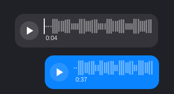

# Voice messages

Audio attachments render as an inline player with a measured waveform,
remaining time, playback progress, and pause/resume. Clicking the waveform
seeks. Space or Return toggles the focused player; Left/Right seek five
seconds when the timeline has focus. Switching recordings, leaving the
conversation, or closing the panel stops playback. Loading an attachment
never starts it without an explicit play request.

The player uses Qt Multimedia (`qt6-multimedia` on Arch;
`qml6-module-qtmultimedia` on Ubuntu). FFmpeg/FFprobe provide the existing CAF
to Opus conversion and the waveform analysis. Missing analysis tools or an
unsupported format produce an unavailable inline preview; the attachment's
Save action remains available.

The waveform is computed from the recording, not generated decoration. The
fetcher verifies an audio container signature, selects its demuxer explicitly,
and confirms an audio stream with FFprobe before exposing a playable source.
It decodes mono 24 kHz signed PCM into memory and takes RMS values in 64
equal-time buckets, normalized within that recording. Silence remains flat.
A narrow player groups those buckets without dropping peaks.

Analysis has a 100 MB source ceiling, a ten-second metadata deadline, a
15-second decode deadline, and a 600-second/28.8 MB PCM limit. Longer recordings
retain their duration and a simple seek timeline instead of a misleading
partial waveform. Decoding failures likewise retain playable media when the
container and audio stream were verified. The verified mono PCM is wrapped in a generated WAV for Qt playback, cached privately and counted in LRU eviction;
only the existing private media cache contains the attachment itself.

Tests use generated WAV tones and play muted. The Qt runtime checks actual
pause/resume, seek, completion, replay, and focus behavior, while TypeScript
tests cover envelope math, malformed metadata, and decoder bounds:

```sh
bun test audio-waveform.test.ts
python3 scripts/test-audio-ui.py
```



Analysis happens only on a play click, never on thread open. Qt opens only the generated 24 kHz mono PCM WAV, never the received container. This bounds playback to ten minutes; unavailable normalization and missing tools fall back to external mpv or Save. The normalized file also caches the waveform by source content hash. The view owns the optional multimedia Loader independently of message delegates; model reloads preserve playback, leaving the conversation or closing the view stops it. Missing QtMultimedia falls back to an ordinary attachment chip.

Generated WAVs put their data at offset 4096 behind an extended format chunk and padding, so initial format probing sees only generated bytes. Versioned, content-hash cache names invalidate the previous 44-byte-header format and avoid long source filenames. External mpv is owned by the view and stopped with inline playback.
