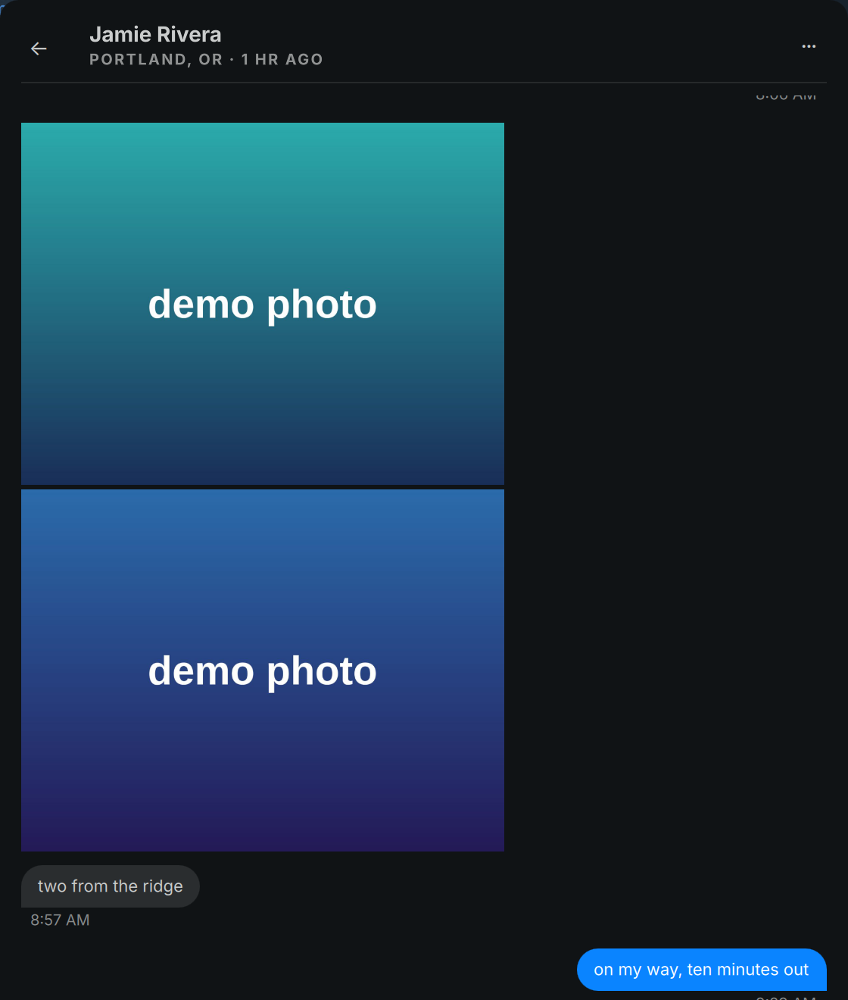

# Shared city in conversations

A synthetic conversation (invented contact), rendered by `scripts/demo/blip-shots`.

With `shared_city=on` in `$HOME/.config/blip/bridge.conf`, an open direct
conversation shows the friend's shared city beneath their name. Observations
older than five minutes include their age, such as `City, ST · 1 hr ago`. The
phone or email returns when no city can be matched. When Find My matches the
person but reports no location, the subtitle says **Location unavailable**.
Both the panel and app use
the same component. The setting defaults to off.

The city comes from ongoing Find My sharing, not a saved Contacts address.
Only people already sharing with your Mac's Apple Account can appear.

## Mac setup

Update the Mac's `contacts` tool and install its sibling `findmy_city.py`
using `bridge/mac/install.sh` or `blip-setup`. The Linux update needs
`SharedCity.qml`, `city.ts`, `city-policy.ts`, and generated `City.mjs` as well
as `BlipView.qml`.

The Mac must be signed in, unlocked, and have Find My's **People** tab
selected. Accessibility must already be granted to the SSH host process
(`sshd-keygen-wrapper`), as for optional read pushes. Blip checks the existing
grant without prompting. It can open Find My in the background, but never
switches tabs, selects a person, or changes sharing. For an exactly matched
person whose numeric location age is stale, it briefly brings Find My forward to
refresh, then restores the previous Mac app unless you chose another app in
the meantime. Each handle can trigger this at most once every 15 minutes,
including failed attempts. **Paused** rows never change focus and show
**Location unavailable**, because their observation age is unknown. Enabling
`shared_city` opts into this brief focus change. If Find My is opening for the
first time, let it finish loading; a later lookup can try again after the cooldown.

The accessibility layout was verified on macOS 27.2. This first version
recognizes English distance/age labels and unambiguous `City, ST` places with
two-letter state codes, plus `City Province Canada` (displayed as `City, Province`).
Older layouts, other languages, named places such as Home, street addresses,
and unavailable locations produce no city. No private Apple API, cache
decryption, Screen Recording, or disabled system protections are needed.

## Identity and freshness

Phone numbers match all digits, including country code; emails match exactly
without case. A Find My row displaying a name must match the exact saved personal
name in the Mac's Contacts, including a name saved in just one field. Every card
with that name must contain the exact conversation handle; mirrored cards can
have different additional fields. Nicknames, organizations, conflicting cards, duplicate
Find My rows, and incomplete lookups are suppressed.

Blip checks the visible direct conversation once a minute. Each successful
snapshot expires within five minutes. Location observations up to 24 hours old
can be shown with their age; older observations are hidden. Stale observations
trigger a refresh attempt when the 15-minute cooldown allows it, and retain
their actual observation timestamp. The UI checks expiry and age every second.
A failed refresh removes the city; changing conversations
or closing the surface clears it immediately. Late replies from an earlier
conversation are discarded, including when returning to that conversation.

Only the requested handle, city, and UTC observation/expiry timestamps cross
the SSH bridge. Names, distances, map contents, coordinates, and full
accessibility descriptions remain on the Mac. City data lives in memory;
there is no history, notification, message read, or message send.
An empty private `$HOME/.blip/findmy-ui.lock` on the Mac serializes the focus
refresh across the two surfaces. It contains no location or contact data.
A private (0600) sibling `findmy-refresh.json` stores at most 256 SHA-256
handle hashes and last-attempt timestamps, shared across bridge processes.
These hashes are identifiers, not anonymization. No names, cities, or location
history are stored. Expired entries are pruned on the next allowed attempt;
full, corrupt, or unsafe state suppresses foreground refreshes. During a
cooldown, Blip uses the current passive snapshot with the usual identity and
24-hour age checks; it never reuses a persisted city.

Disable the feature with `shared_city=off`. Changes take effect on the next
lookup (within a minute while a conversation is open).

## Verification

`bun test city.test.ts` exercises identity, malformed input, transport errors,
configuration, and expiry. `python3 bridge/mac/test_findmy_city.py` exercises
the Mac parser and accessibility adapter using synthetic fixtures.
`python3 scripts/test-city-ui.py` runs the shipping QML component against a
fake helper with Quickshell, checking conversation changes and stale replies.
`scripts/demo/blip-shots` renders the shipping conversation UI with invented
contacts, including a shared city. No real conversation is used.

`python3 scripts/test-city-view.py` exercises the full shipping conversation
header offscreen with synthetic panel, app, and unavailable-location cases.

For a running instance, `qs -p /usr/share/omarchy/shell ipc call nixfred.blip citystatus`
returns safe per-surface flags and a bounded lookup reason. It includes no chat
identifier, name, city, or message text. `location-unavailable` means a person
was matched in Find My but the Mac returned no location; `no-match` means no
unambiguous sharing identity; `source-unavailable` means Find My could not be
read. This command is read-only and does not open or mark a conversation read.
