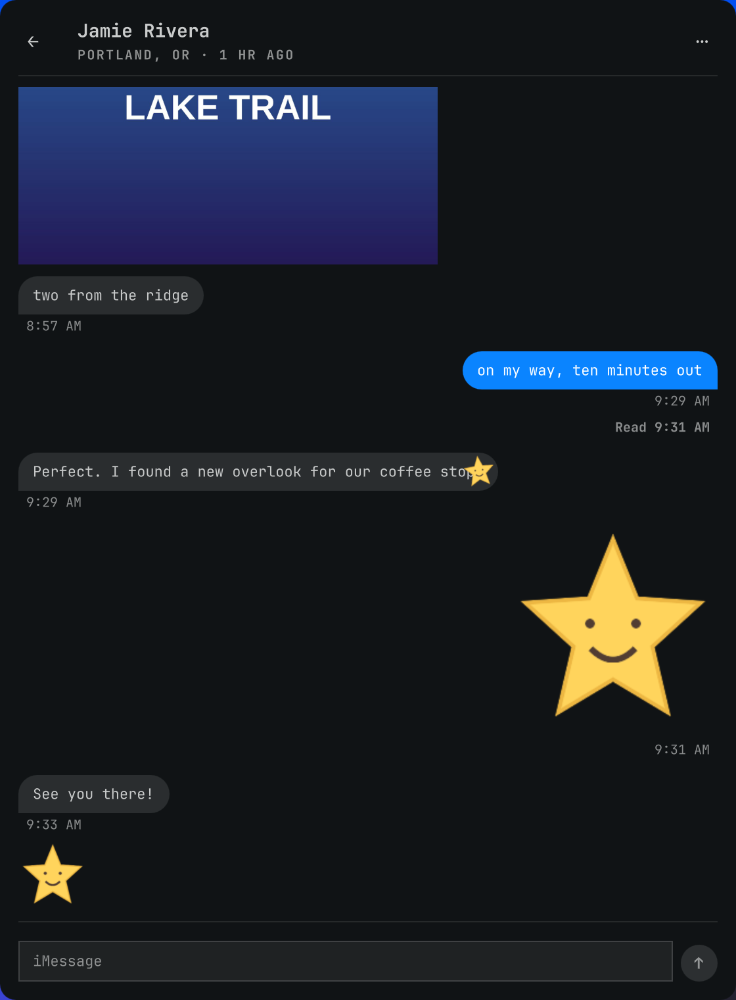

# Receiving stickers

The rich bridge distinguishes a sticker from a photo using
`attachment.is_sticker` or a sticker association (`1000` or `2007`). A small
PNG, transparent photo, filename, or MIME type alone does not make a sticker.
Standalone stickers render without a photo bubble. Associated stickers belong
to their original message rather than appearing as duplicate message rows.

| Received media | Inline display |
|---|---|
| PNG, JPEG | Original pixels; PNG transparency preserved |
| HEIC / HEIF | PNG bounded to 2048 pixels per edge, converted by the Mac's `sips`; alpha preserved |
| GIF | Original animated file through Qt's `AnimatedImage` |
| Animated WebP | Original animated file through Qt's `AnimatedImage` |
| APNG, including APNG declared `image/png` | Lossless animated WebP preview; original PNG retained for explicit Open, Copy, and Save |
| HEICS / HEIC sequence | Animated color and grayscale alpha tracks combined into lossless WebP when the container layout is recognized |
| Sticker video | Bounded WebP animation; a separate grayscale alpha track is used when present |

All inline sticker rasters, including static PNG/JPEG and converted HEIC
stills, must have positive dimensions no larger than 2048 pixels per edge.
Larger raw static assets show an unavailable placeholder; HEIC stills are resized on the Mac before transfer. The table's original-pixel and full-size descriptions
apply within that limit.

HEICS conversion uses the animated pair in a four-track container. FFprobe
checks dimensions, frame count, duration, and track layout before FFmpeg
decodes it. Supported animations have at most 100 frames, eight seconds, a
2048-pixel edge, and 64 million total decoded pixels. Unknown or larger
sequences get a transparent still when available. Missing tools, malformed
media, timeouts, or an oversized converted preview keep the usable still;
the fetch result explicitly reports `animationUnavailable`. HEICS explicit
Open/Copy/Save currently uses the Mac's bounded transparent still, not a
native HEICS export. Video Open still opens the original video externally.

Qt's PNG reader displays APNG as a single frame on the tested Qt 6 stack.
That is why the inline APNG conversion exists. Animated images do not retain
all decoded frames in the QML cache, and the view pauses playback outside the
visible conversation viewport.

## Associations and placement

The wire attachment gains a `sticker` object with a bounded plain-text label,
source (`memoji`, `genmoji`, `user`, `app`, or `unknown`), optional app name,
animation hint, and optional placement. The bridge exposes only selected
fields, never the raw property list or a Mac attachment path.

Associated media appears in the parent message's `stickers` array:

```json
{
  "attachment": {
    "id": "42",
    "name": "sticker.png",
    "mime": "image/png",
    "bytes": 1024,
    "sticker": {"source": "user", "label": "Sticker", "animated": false}
  },
  "guid": "EXAMPLE-STICKER-GUID",
  "part": 0,
  "from_me": false,
  "by": null,
  "ts": "2026-11-06T12:01:00Z",
  "placement": {"x": 0.9, "y": 0.1, "scale": 1, "rotation": -0.2, "parentWidth": 164}
}
```

`sticker_user_info` stores the normalized center in `sxs`/`sys`, scale in
`ssa`, clockwise radians in `sro`, and the source parent preview width in
`spw`. Blip validates every value. Its small-panel layout preserves the
relative position and rotation while bounding the rotated rectangle to the
rendered target. This is an approximation, not pixel-perfect reconstruction
of the sender's Messages layout; `parentWidth` is retained as metadata.

`p:N/GUID` identifies a body part, not an index into the attachment array.
Blip can safely position part 0 on text or the first rendered image. Other
parts, missing geometry, or an unavailable placement target use a compact
attached-sticker strip. Nested associations resolved inside the loaded window
retain their media on the surviving root bubble but use the strip because
their coordinates refer to another sticker. Native sticker effect shaders
are not recreated; Blip displays the decoded media pixels.

Legacy type `1000` decorations are additive, so several stickers from one
sender survive. A type `2007` sticker occupies that sender's tapback slot for
one body part; a later emoji replaces it, and type `3007` removes it. It never
becomes a fabricated star emoji. Legacy sticker rows hidden by Recently
Deleted stay hidden; other legacy removal encodings have not been verified.
Type `2007` overlays carry `reaction: true` so the client can use a round
reaction badge without putting ordinary placed stickers inside a bubble.
Sticker metadata is fetched for loaded parents even when the associated event
is outside the message window. A current sticker whose parent is outside the
window remains visible on its own. Missing media remains a labeled unavailable
sticker instead of disappearing.

The decoration's timestamp advances the parent's `seen_ts` without changing
its displayed message time. Self-thread deduplication preserves decorations
and that boundary from either echo. At most 24 distinct associated stickers
are rendered per bubble; an overflow count explains omitted decorations.
Unsent parent messages hide their sticker decoration.

## Sending and privacy

This receiving path does not add a native sticker-send command. Sending an
ordinary transparent image through the existing attachment composer remains
an image send; it does not place a native sticker on a selected message.
An Accessibility route through Messages' sticker picker needs separately
verified target and sticker identities before it can safely be offered.

A separate synthetic feasibility probe found a possible standalone route:
public ImageIO encoded a transparent HEIC with `tiff:DocumentName` and
`dc:description`; AppKit accepted it as `NSAdaptiveImageGlyph`, and its
identifier survived an attributed-string RTFD roundtrip. Plain PNG and
untagged HEIC were not accepted. Apple's
[Genmoji API overview](https://developer.apple.com/videos/play/wwdc2024/10220/)
documents rich-text and pasteboard support, but the probe did not access the
clipboard, open Messages, or send. A native Messages receipt and exact target
handling remain unverified, so no native sticker-send control is shipped.
Bubble placement is a further capability beyond standalone glyph transport.

Media uses the existing private attachment cache (directory `0700`, files
`0600`, 500 MB LRU). Automatic transfers retain the five-MB output ceiling;
the absolute source/transport ceiling remains 100 MB. Conversion inputs are
private temporary **media** files, always removed, or bounded pipes. FFmpeg
and FFprobe receive fixed arguments, deadlines, output caps, and a restricted
protocol list. No message body enters arguments, files, or logs. Read-state
snapshots remain metadata only, and no Messages database is written.
The sticker render path accepts only PNG, JPEG, GIF, or WebP raster signatures
matching the advertised or converted format, with nonzero dimensions no
larger than 2048 pixels per edge. Cache hits are checked too. SVG and other
resource-bearing formats are never loaded through sticker attribution.

## Evidence and checks

The parsers and conversion code are independently implemented from observed
format facts; no upstream implementation was copied or vendored. The sources
used to cross-check those facts are pinned here:

- [ReagentX/imessage-exporter attachment fields and source metadata](https://github.com/ReagentX/imessage-exporter/blob/47b75148b82e666b25db1211ce1dcecf32ab40a8/imessage-database/src/tables/attachment.rs)
  (`is_sticker`, `pid`, Memoji/Genmoji source, sequence media types).
- [Its association type definitions](https://github.com/ReagentX/imessage-exporter/blob/47b75148b82e666b25db1211ce1dcecf32ab40a8/imessage-database/src/tables/messages/message.rs)
  (`1000`, `2007`, `3007`). That project is GPL-3.0 licensed.
- [Its documented HEICS track roles](https://github.com/ReagentX/imessage-exporter/blob/47b75148b82e666b25db1211ce1dcecf32ab40a8/imessage-exporter/src/app/compatibility/converters/sticker.rs).
  Blip uses one bounded color/alpha filter into lossless WebP rather than that
  implementation's temporary PNG sequences and GIF palette workflow.
- [openclaw/imsg sticker geometry metadata](https://github.com/openclaw/imsg/blob/1bc0679663bf3978a744a61a5a9161d9ba518764/Sources/IMsgHelper/StickerAssets.inc)
  and [placement fixtures](https://github.com/openclaw/imsg/blob/1bc0679663bf3978a744a61a5a9161d9ba518764/Tests/IMsgHelperTests/StickerPlacementTests.m)
  (`sxs`, `sys`, `ssa`, `sro`, `spw`). That project is MIT licensed; its
  sending implementation is not used.

The current gateway schema was checked for the needed column names and types
without selecting message rows or attachment content. All media tests use
generated synthetic fixtures:

```sh
bun test stickers.test.ts
python3 -m unittest discover -s bridge/mac -p test_stickers.py
python3 scripts/test-sticker-ui.py
```

The Qt test runs the shipping `StickerImage.qml`, verifies background showing
through transparent corners, checks that both converted animation types
advance frames, and checks playback pause. It does not open Messages or send.

In the upstream UI, native sticker reactions are shown in a compact strip attached to the parent message. Known part-0 placements overlay the text or first image surface; unknown placements remain in the strip. The fork’s reaction-balloon restyle is not included.



Legacy type-1000 rows retain upstream unread counting and toast behavior. Decoder output is capped to min(100, floor(64 million / frame pixels)) frames even when container frame counts lie. Failed APNG conversions cache the still fallback.

Failed video previews are remembered for one hour to avoid repeated decoder work on thread open; explicit Open remains available.
